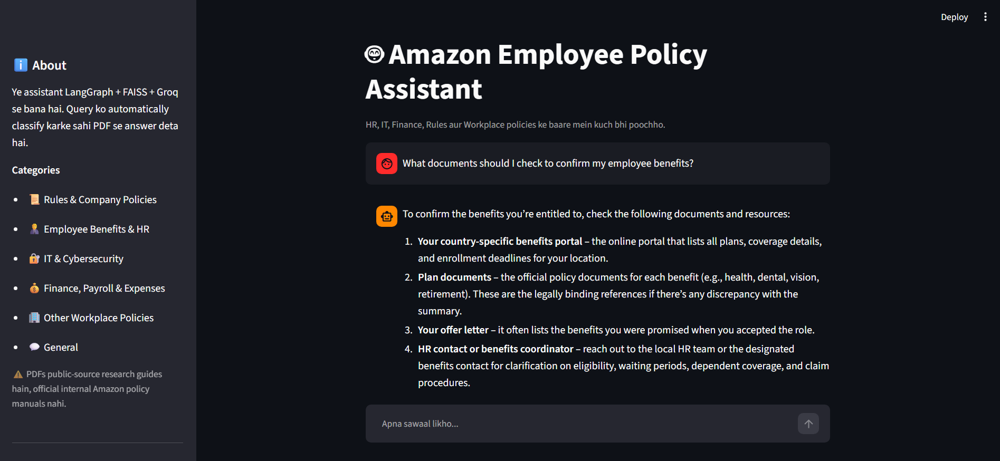

# Amazon Employee Policy Assistant



<p align="center">
  <strong>Retrieval-Augmented Generation | LangGraph | FAISS | Groq | Hugging Face | Streamlit</strong>
</p>

<p align="center">
  An AI-powered document assistant that automatically classifies employee questions and retrieves relevant information from category-specific PDF knowledge sources.
</p>

---

## 1. Project Overview

The **Amazon Employee Policy Assistant** is a document-based AI chatbot designed to answer questions related to employee benefits, HR, IT security, finance, company rules, and workplace policies.

The application uses Retrieval-Augmented Generation (RAG) to retrieve relevant information from PDF documents before generating an answer. Instead of relying exclusively on the language model's internal knowledge, it uses a document retrieval pipeline to provide context for policy-related questions.

The system combines **LangGraph, FAISS, Hugging Face embeddings, Groq, LangChain, and Streamlit** to create an interactive question-answering application.

When a user submits a question, the application classifies it into a relevant category, routes it to the corresponding retrieval workflow, retrieves relevant document chunks, and generates a response using the retrieved context.

The Streamlit interface supports conversational interaction, suggested questions, category labels, chat history during the session, and a Clear Chat option.

**Important:** The PDF files used by this project are public-source research guides, not official internal Amazon policy manuals. The application is a portfolio and learning project and must not be treated as an authoritative source of current Amazon employee policies.

## 2. Problem Statement

Employees may need to search through multiple documents to find information about benefits, cybersecurity, payroll, workplace conduct, and company rules.

Searching lengthy documents manually can be time-consuming. A general-purpose chatbot may also produce answers that are not supported by the available policy documents.

This project addresses these challenges by combining automatic question classification, category-specific document retrieval, and context-based answer generation in a single conversational interface.

## 3. Project Objectives

- Build a conversational assistant for document-based policy questions.
- Automatically classify user questions into predefined categories.
- Route questions to the appropriate document retrieval workflow.
- Load and process PDF knowledge sources.
- Convert document chunks into vector embeddings.
- Use FAISS for semantic similarity search.
- Generate answers using retrieved document context.
- Handle general questions separately from policy-related questions.
- Provide a simple Streamlit chat interface.
- Display the detected category alongside the answer.
- Allow users to try suggested questions.
- Support clearing the current conversation.

## 4. Key Features

### Automatic Question Classification

The application classifies user queries into predefined categories so that the appropriate retrieval workflow can process each question.

### Category-Specific Document Retrieval

Different categories use separate retrieval paths for more targeted document search.

### Retrieval-Augmented Generation

Relevant document chunks are retrieved before the language model generates an answer.

### Semantic Search with FAISS

FAISS performs vector similarity search over the embedded document chunks.

### Hugging Face Embeddings

A sentence-transformer embedding model converts document text into vector representations suitable for semantic retrieval.

### LangGraph Workflow

LangGraph coordinates classification, conditional routing, retrieval, and response generation.

### Groq LLM Integration

The configured Groq language model generates responses using the context supplied by the retrieval workflow.

### Interactive Streamlit Interface

The UI provides:

- Conversational chat interface
- Suggested example questions
- User and assistant message history
- Detected category labels
- Loading indicator while generating a response
- Clear Chat functionality
- Sidebar information about the application

### General Query Handling

Questions classified as general can be handled through a separate path without requiring category-specific policy retrieval.

## 5. Supported Categories

The application defines six query categories.

| Category | Example Topics |
|---|---|
| Rules & Company Policies | Code of conduct, company rules, conflicts of interest |
| Employee Benefits & HR | Employee benefits, paid leave, HR procedures |
| IT & Cybersecurity | Phishing emails, security incidents, account protection |
| Finance, Payroll & Expenses | Travel expenses, payroll, reimbursement questions |
| Other Workplace Policies | Workplace harassment, workplace procedures |
| General | Greetings and questions that do not require policy-document retrieval |

The classification result determines which retrieval path is selected by the LangGraph workflow.

## 6. Application Screenshot

The screenshot below shows the Streamlit application with its sidebar, supported categories, suggested question, assistant response, category information, and chat input.


## 7. System Architecture

```text
                  User Question
                        |
                        v
                 Streamlit Chat UI
                        |
                        v
                  LangGraph App
                        |
                        v
                 Classifier Node
                        |
                        v
               Conditional Routing
                        |
          +-------------+-------------+
          |             |             |
          v             v             v
       Rules RAG      HR RAG        IT RAG
          |             |             |
          v             v             v
       Rules PDF      HR PDF        IT PDF
          |             |             |
          +-------------+-------------+
                        |
             +----------+----------+
             |                     |
             v                     v
         Finance RAG           Workplace RAG
             |                     |
             v                     v
         Finance PDF           Workplace PDF
             |                     |
             +----------+----------+
                        |
                        v
                Retrieved Context
                        |
                        v
                 Response Node
                        |
                        v
                 Groq Language Model
                        |
                        v
                  Final Answer
                        |
                        v
               Streamlit Chat UI
```

The diagram represents the intended category-based RAG workflow. The exact node names and graph connections are defined in `rag_app.py`.

General queries can follow a separate path that does not require document retrieval.

## 8. Retrieval-Augmented Generation (RAG)

RAG combines information retrieval with language generation.

In this project, the retrieval component searches the configured policy documents and supplies relevant text to the language model.

The pipeline consists of the following stages.

### 8.1 PDF Document Loading

The project uses PDF documents as its knowledge sources.

PDF loading is handled by the document-processing workflow, which is imported into the Streamlit application from `rag_app.py`.

The documents are organized around the application's supported policy categories.

### 8.2 Text Splitting

Long PDF documents can be divided into smaller text chunks before indexing.

A text splitter helps retrieve focused passages rather than requiring the language model to process entire documents.

Typical splitter settings include:

```python
RecursiveCharacterTextSplitter(
    chunk_size=500,
    chunk_overlap=100
)
```

These values are illustrative. The actual chunk size and overlap must match the configuration in `rag_app.py`.

### 8.3 Text Embeddings

The project uses Hugging Face embeddings to represent document text numerically.

The embedding model identified for this project is:

```text
sentence-transformers/all-MiniLM-L6-v2
```

Embedding vectors allow semantically similar questions and document passages to be matched even when they do not contain exactly the same words.

### 8.4 FAISS Vector Store

FAISS provides vector similarity search over the embedded document chunks.

The retrieval workflow uses the vector index to find passages that are relevant to a user's question.

The number of returned chunks depends on the retriever configuration in `rag_app.py`.

### 8.5 Context Retrieval

After the query has been classified, the corresponding retrieval workflow searches its category-specific knowledge source.

The retrieved text is passed to the response-generation stage as context.

### 8.6 Answer Generation

The Groq language model uses the question and retrieved context to generate a response.

For reliable document-based answers, the prompt should instruct the model to:

- Prioritize the supplied document context.
- Avoid inventing policy details.
- State when the available documents do not contain enough information.
- Distinguish retrieved information from general guidance.
- Avoid presenting research material as official internal Amazon policy.

The quality of the answer depends on document coverage, retrieval relevance, prompt design, and model behavior.

## 9. LangGraph Workflow

LangGraph coordinates the application's processing steps using a graph-based workflow.

The Streamlit application loads the graph from `rag_app.py`:

```python
@st.cache_resource(show_spinner="Loading PDFs and building indexes...")
def load_graph():
    from rag_app import app
    return app
```

The graph is cached as a Streamlit resource so it can be reused across reruns within the same application process.

### Query Execution

When a user submits a question, the UI invokes the graph:

```python
result = graph_app.invoke({
    "messages": [("human", query)],
    "query_type": "general",
    "retrived_context": "",
})
```

The graph processes the supplied state and returns the updated messages and classification information.

The application then extracts the final message:

```python
answer = result["messages"][-1].content
category = result.get("query_type", "general")
```

The exact classification and routing logic resides in `rag_app.py`.

### Main Workflow Responsibilities

| Component | Responsibility |
|---|---|
| Streamlit UI | Accepts questions and displays responses |
| Classifier | Determines the query category |
| Conditional Router | Selects the appropriate workflow |
| Category Retriever | Searches the relevant vector index |
| Context Builder | Supplies retrieved text to the response stage |
| Response Node | Generates the final answer |
| Graph State | Carries messages, category, and retrieval context |

## 10. Streamlit User Interface

The user interface is implemented in `streamlit_app.py`.

### Page Configuration

The application configures its title, icon, and layout using Streamlit:

```python
st.set_page_config(
    page_title="Amazon Employee Policy Assistant",
    page_icon="🤖",
    layout="centered",
)
```

### Sidebar

The sidebar contains:

- Application description
- Supported categories
- Suggested questions
- Clear Chat button
- A disclaimer explaining that the PDFs are public-source research guides

### Suggested Questions

The application provides example questions such as:

- How many days of paid sick leave do I get?
- What should I do if I get a phishing email?
- How do I claim travel expenses?
- How do I report workplace harassment?
- What is the code of conduct on conflicts of interest?

Clicking a suggested question places it into the pending-query state for processing.

### Chat History

The application stores conversation messages in Streamlit session state.

User and assistant messages are rendered using `st.chat_message()`, while the chat input is provided by `st.chat_input()`.

The history persists during the active session but is not a permanent database-backed conversation history.

### Category Display

After a response is generated, the application displays the detected category beneath the answer.

### Clear Chat

The Clear Chat button resets the stored conversation and pending question, then reruns the application.

## 11. Technology Stack

| Technology | Purpose |
|---|---|
| Python | Core application logic |
| Streamlit | Interactive chat interface |
| LangGraph | Workflow orchestration and conditional routing |
| LangChain | Document processing and LLM integrations |
| Groq | Language model inference |
| `openai/gpt-oss-20b` | Model configured for the project, subject to provider availability |
| Hugging Face | Embedding model integration |
| `sentence-transformers/all-MiniLM-L6-v2` | Text embedding model |
| FAISS | Vector similarity search |
| PyPDFLoader | PDF document loading |
| RecursiveCharacterTextSplitter | Document chunking |
| python-dotenv | Environment variable management |

Confirm the precise package versions and model identifier in the repository before deployment.

## 12. Project Structure

The following is a suggested structure. Preserve the actual PDF filenames and source paths expected by `rag_app.py`.

```text
Amazon_Employee_Assistant/
│
├── Amazon_Employee_Policy_Assistant.png
├── README.md
├── streamlit_app.py
├── rag_app.py
├── requirements.txt
├── .env
├── .gitignore
│
└── data/
    ├── rules_and_company_policies.pdf
    ├── employee_benefits_and_hr.pdf
    ├── it_and_cybersecurity.pdf
    ├── finance_payroll_and_expenses.pdf
    └── other_workplace_policies.pdf
```

**Important:** The PDF filenames above are examples, not verified filenames from your repository. Use the actual filenames and folder paths referenced by `rag_app.py`.

The `streamlit_app.py` file handles the user interface. The `rag_app.py` file defines the retrieval workflow and graph application. The PDF documents provide the knowledge sources.

## 13. Installation and Setup

### Step 1: Clone the Repository

Replace the placeholders with your actual GitHub repository URL and directory name.

```bash
git clone <YOUR_GITHUB_REPOSITORY_URL>
cd <YOUR_PROJECT_FOLDER>
```

### Step 2: Create a Virtual Environment

```bash
python -m venv .venv
```

Activate it on Windows PowerShell:

```powershell
.\.venv\Scripts\Activate.ps1
```

### Step 3: Install Dependencies

```bash
python -m pip install -r requirements.txt
```

The requirements file should include all packages imported by both `streamlit_app.py` and `rag_app.py`.

Typical dependencies for this architecture include:

```text
streamlit
langgraph
langchain
langchain-community
langchain-groq
langchain-huggingface
langchain-text-splitters
faiss-cpu
sentence-transformers
pypdf
python-dotenv
```

These are indicative package names. Use the actual `requirements.txt` and compatible versions from your project.

## 14. Environment Configuration

Create a `.env` file in the project root:

```env
GROQ_API_KEY=your_groq_api_key_here
```

Replace the placeholder with your own Groq API key.

Ensure that `rag_app.py` loads the environment variable with the same name.

**Security best practices:**

- Never hardcode API keys in source code.
- Never commit `.env` to GitHub.
- Add `.env` to `.gitignore`.
- Configure deployment secrets through the hosting provider's environment-variable settings.

## 15. Run the Application

From the project directory, execute:

```bash
python -m streamlit run streamlit_app.py
```

Wait for Streamlit to display the local application URL, then open it in your browser.

On the first run, loading the embedding model, reading PDFs, and building vector indexes may take additional time.

### How to Use

1. Launch the Streamlit application.
2. Review the available categories in the sidebar.
3. Enter a question in the chat input or select a suggested question.
4. Wait for the graph to classify and process the query.
5. Review the generated response.
6. Check the displayed category.
7. Ask another question or select Clear Chat to start a new conversation.

## 16. Example Questions

### Rules & Company Policies

- What is the code of conduct on conflicts of interest?
- Where can I find information about company rules?

### Employee Benefits & HR

- What documents should I check to confirm my employee benefits?
- Where can I find information about leave eligibility?

### IT & Cybersecurity

- What should I do if I get a phishing email?
- How should I respond to a suspected security incident?

### Finance, Payroll & Expenses

- How do I claim travel expenses?
- Where can I find information about reimbursement procedures?

### Other Workplace Policies

- How do I report workplace harassment?
- Where can I find workplace policy information?

The answers depend on the contents of the configured PDF knowledge sources. These example questions do not imply that the PDFs contain every answer.

## 17. Error Handling and Troubleshooting

### Missing PDF Files

Check that all required PDF files exist at the paths expected by `rag_app.py`.

### Missing API Key

Confirm that `GROQ_API_KEY` is configured correctly and loaded before the language model is initialized.

### Model Availability Errors

Verify that the configured model is available to your Groq account and that the model identifier matches the integration's requirements.

### Embedding Model Loading

The embedding model may need to be downloaded on first initialization. Confirm that the environment has sufficient access and resources.

### Incorrect Classification

A vague or ambiguous query may be routed to the wrong category. Clearer questions and better classifier instructions may improve routing.

### Irrelevant Answers

Check the PDF content, chunking configuration, embedding model, retriever settings, and response prompt.

### Slow First Startup

PDF loading, embedding generation, and index creation can increase initial startup time. Caching resources can reduce repeated initialization within the same process.

## 18. Limitations

- Retrieval quality depends on the completeness and quality of the PDF documents.
- Scanned PDFs may require OCR.
- The classifier may occasionally select an incorrect category.
- Retrieved chunks may not contain sufficient information to answer a question.
- LLM responses can contain errors or unsupported statements.
- General queries are not necessarily grounded in policy documents.
- Chat history is stored in session state and is not permanent.
- Model availability and API usage limits depend on the configured provider.
- The included public-source research guides are not official internal Amazon policy manuals.
- The application must not be used as the definitive authority for employee eligibility, legal rights, payroll, benefits, or internal company procedures.

## 19. Future Improvements

Potential improvements include:

- Add source citations and PDF page references to answers.
- Display retrieved document excerpts in the interface.
- Add confidence-aware query classification.
- Improve handling of questions that match multiple categories.
- Add OCR support for scanned PDFs.
- Add document update and re-indexing support.
- Persist conversation history in a database.
- Add retrieval evaluation and automated tests.
- Add logging and performance monitoring.
- Improve handling of model timeouts and API failures.
- Add authentication and access controls.
- Deploy the application with a documented public demo URL.

## 20. Skills Demonstrated

This project demonstrates practical experience with:

- Python development
- Streamlit UI development
- Retrieval-Augmented Generation (RAG)
- LangGraph workflow orchestration
- Conditional query routing
- LangChain integrations
- Groq LLM integration
- Hugging Face embeddings
- FAISS vector search
- PDF document processing
- Text chunking
- Semantic retrieval
- Prompt engineering
- Context-grounded answer generation
- Session-state management
- Environment variable management
- AI application development

## 21. Conclusion

The Amazon Employee Policy Assistant demonstrates how Retrieval-Augmented Generation can be applied to document-based question answering.

By combining automatic query classification, category-specific retrieval, FAISS similarity search, Hugging Face embeddings, LangGraph orchestration, and Groq inference, the application provides a structured way to search policy research documents through a conversational interface.

The project brings together document processing, semantic search, LLM integration, and Streamlit UI development in an end-to-end AI application.

The generated answers should always be checked against the underlying source documents, especially when a question concerns real employee benefits or official company policy.

## Author

**Parth Solanki**

BCA (Hons) Student | Machine Learning | Data Science | Generative AI

## License

This project is intended for educational, portfolio, and demonstration purposes. Add a formal license file if you wish to define reuse permissions.
