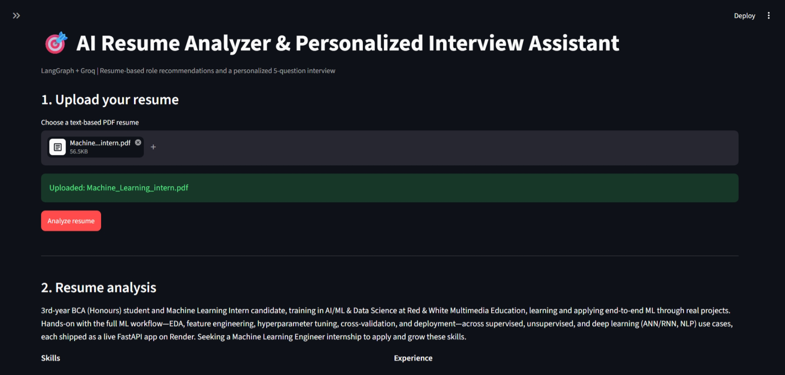
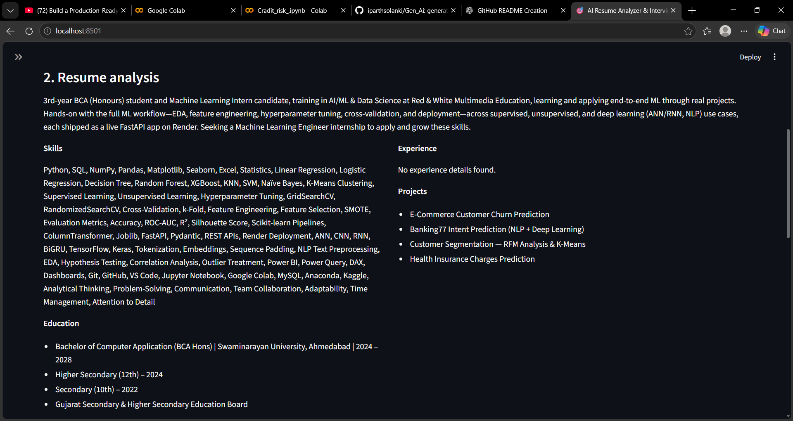
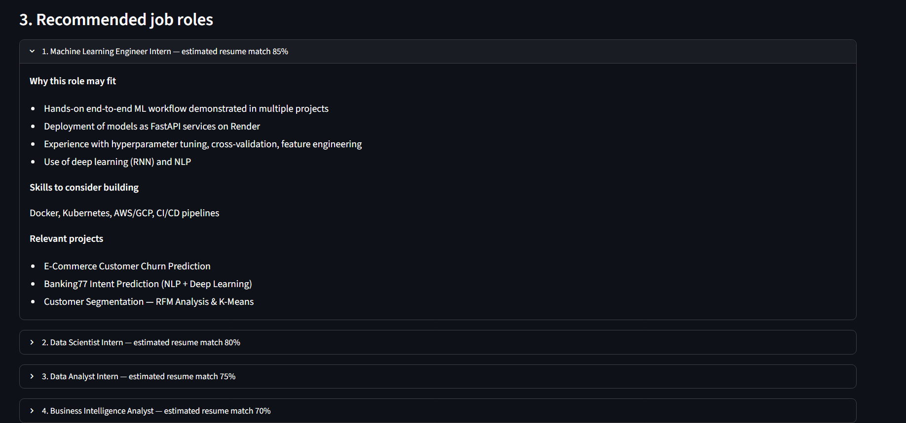
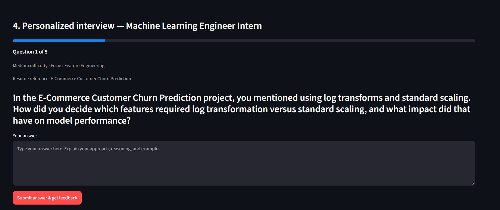

# AI Resume Analyzer & Personalized Interview Assistant









<p align="center">
  <strong>LangGraph | Groq | Python | Pydantic | Streamlit | Generative AI</strong>
</p>

<p align="center">
  An AI-powered career preparation application that analyzes resumes, recommends suitable job roles, identifies potential skill gaps, and conducts personalized technical interviews.
</p>

---

## 1. Project Overview

**AI Resume Analyzer & Personalized Interview Assistant** is an AI-powered career preparation application that helps candidates understand their professional profiles, explore relevant job opportunities, and prepare for interviews using their own resume information.

Traditional interview preparation often relies on generic question lists that may not match a candidate's technical background or projects. This application creates a more personalized experience by connecting resume analysis, job role recommendations, and interview practice in one workflow.

The candidate uploads a text-based PDF resume. The application extracts information such as skills, education, experience, and projects. A language model then analyzes this information and recommends relevant job roles with estimated resume-match percentages.

After selecting a role, the candidate can complete a five-question personalized interview. Each answer is evaluated by the AI system, which provides a score, technical feedback, strengths, areas for improvement, and an example of a stronger answer.

The application uses **Python, LangGraph, Groq, Pydantic, and Streamlit** to combine LLM-powered analysis with an interactive user interface.

## 2. Problem Statement

Candidates preparing for technical interviews commonly face several challenges:

- They may not know which job roles best match their current skills.
- They may find it difficult to identify missing or underdeveloped skills.
- Generic interview questions may not reflect their own projects or experience.
- They may not receive immediate feedback while practising answers.
- They may struggle to identify strengths and weaknesses before an actual interview.

This project addresses these challenges by providing a single application for resume analysis, job role discovery, skill-gap identification, personalized interview practice, and performance review.

## 3. Project Objectives

The main objectives are:

- Extract meaningful information from PDF resumes.
- Generate a structured candidate profile.
- Identify skills, education, experience, and projects.
- Recommend relevant job roles based on resume evidence.
- Estimate resume alignment for recommended roles.
- Explain why a particular role may suit the candidate.
- Highlight skills worth developing for a target position.
- Generate five personalized interview questions.
- Evaluate candidate answers using an LLM.
- Provide constructive, actionable feedback.
- Calculate interview performance scores.
- Generate a downloadable interview report.

## 4. Key Features

### Resume Upload and Analysis

- Upload a text-based PDF resume through the Streamlit interface.
- Extract the resume text for further processing.
- Analyze the candidate's professional background.
- Display skills, education, experience, projects, and a summary.
- Reset previous analysis when a different resume is uploaded.

### Intelligent Job Role Recommendations

- Recommend relevant job roles based on the candidate's resume.
- Display an estimated match percentage for each role.
- Explain why the candidate may be suitable for a role.
- Identify skills to consider building.
- Highlight relevant projects from the candidate's profile.

### Personalized Interview

- Select a target role from the recommendations.
- Generate exactly five interview questions.
- Tailor questions to the candidate's skills and projects when relevant.
- Display the question number and interview progress.
- Collect answers interactively.

### AI-Powered Answer Evaluation

- Evaluate technical correctness and relevance.
- Assess clarity and depth of answers.
- Provide a score out of 10.
- Highlight strengths.
- Suggest specific improvements.
- Provide an example of a stronger answer.

### Final Interview Report

- Summarize question-wise evaluations.
- Calculate the total score out of 50.
- Calculate the average score out of 10.
- Consolidate strengths and improvement areas.
- Save the report as `interview_report.txt`.
- Allow the candidate to download the report.

## 5. Application Screenshots

The following screenshots demonstrate the main stages of the application.

### 5.1 Resume Upload

The candidate uploads a text-based PDF resume and starts the analysis process.


### 5.2 Resume Analysis

The application presents the extracted candidate summary, skills, education, experience, and projects.


### 5.3 Recommended Job Roles

The application displays recommended positions with estimated resume-match percentages, supporting reasons, skills to consider building, and relevant projects.


### 5.4 Personalized Interview

After selecting a target role, the candidate answers five personalized questions and receives AI-generated evaluation and feedback.


## 6. End-to-End Workflow

```text
                    PDF Resume
                        |
                        v
                  Upload Resume
                        |
                        v
                 Load Resume PDF
                        |
                        v
                Extract Resume Text
                        |
                        v
                 Analyze Resume
                        |
                        v
               Recommend Job Roles
                        |
                        v
                Select Target Role
                        |
                        v
             Generate Five Questions
                        |
                        v
                Submit Answers
                        |
                        v
               Evaluate Each Answer
                        |
                        v
               Calculate Scores
                        |
                        v
              Generate Final Report
                        |
                        v
              Download Interview Report
```

The application separates resume processing, candidate analysis, role recommendations, question generation, and answer evaluation into distinct stages. This makes the workflow easier to understand, maintain, and extend.

## 7. Resume Processing

### 7.1 PDF Upload

The user uploads a PDF resume through the Streamlit file uploader.

The application processes the uploaded file and passes its extracted text to the resume-analysis workflow.

The project is intended for text-based PDFs. Scanned or image-only resumes may require OCR before their contents can be extracted reliably.

### 7.2 Resume Information Extraction

The resume-analysis stage identifies information explicitly present in the document.

| Information | Purpose |
|---|---|
| Summary | Provides a concise overview of the candidate |
| Skills | Identifies technical and professional skills |
| Education | Extracts educational qualifications |
| Experience | Identifies internships and employment details |
| Projects | Summarizes projects and technologies when stated |

The extracted information provides the basis for role recommendations and personalized interview questions.

The system should not be assumed to identify every detail perfectly. Candidates should review the extracted information for accuracy.

## 8. Job Role Recommendation Engine

The role recommendation stage compares the candidate's profile with the characteristics of potential job roles.

The application displays recommendations in expandable sections so candidates can review each role individually.

### Information Displayed

| Field | Description |
|---|---|
| Recommended Role | Suggested job position |
| Estimated Resume Match | Approximate alignment with the candidate's resume |
| Reasons for Recommendation | Evidence supporting the role suggestion |
| Skills to Consider Building | Potential skill gaps or development areas |
| Relevant Projects | Projects related to the recommended position |

### Example Roles

Depending on the candidate's resume, recommendations may include positions such as:

- Machine Learning Engineer Intern
- Data Scientist Intern
- Data Analyst Intern
- Business Intelligence Analyst

These are examples of possible roles, not a fixed list of guaranteed recommendations.

### Understanding Match Percentages

The displayed match percentage is an AI-generated estimate of resume alignment.

It is not a statistically calibrated probability of being hired, a guarantee of interview selection, or a substitute for reviewing the job description.

## 9. Personalized Interview Generation

After reviewing the recommendations, the candidate selects a target role.

The question-generation stage uses the selected role and available resume information to generate exactly five interview questions.

Questions may cover:

- Technical concepts relevant to the role
- Practical problem-solving
- Skills listed in the resume
- Project implementation and decisions
- Relevant experience or internships

When the resume contains useful project details, the generated questions can reference those projects to make interview practice more specific.

## 10. AI-Based Answer Evaluation

The candidate submits an answer for each question. The application then requests a structured evaluation from the configured language model.

### Evaluation Criteria

| Criterion | What It Assesses |
|---|---|
| Technical Correctness | Whether the answer is technically accurate |
| Relevance | Whether the answer addresses the question |
| Clarity | Whether the explanation is understandable |
| Depth | Whether the answer provides sufficient detail |

### Feedback Provided

Each evaluation can include:

- Score out of 10
- Correctness feedback
- Strengths
- Improvement suggestions
- Example of a stronger answer

The purpose is to help candidates understand what they did well and how they can improve their next response.

AI-generated evaluations may occasionally be incorrect or inconsistent. Candidates should use the feedback as study guidance rather than as a definitive assessment of their abilities.

## 11. Interview Progress and Scoring

The interface displays the current question number and a progress bar to help candidates track their progress through the interview.

The interview contains five questions.

### Score Calculation

If each question is scored out of 10:

```text
Maximum Score = 5 × 10 = 50
```

The average score is calculated as:

```text
Average Score = Total Score / 5
```

For example, if the total score is 40:

```text
Total Score   = 40 / 50
Average Score = 40 / 5 = 8 / 10
```

These calculations explain the scoring scale; they are not a claim about any particular candidate's results.

## 12. Final Interview Report

After the interview is completed, the application generates a consolidated report.

The report can include:

- Selected target role
- Estimated resume-match percentage
- Candidate answers
- Question-wise evaluation
- Scores and feedback
- Strengths
- Areas to improve
- Example stronger answers
- Total score
- Average score

The report is saved as:

```text
interview_report.txt
```

The Streamlit interface provides a download option so candidates can retain the report for future practice.

## 13. Technology Stack

| Technology | Purpose |
|---|---|
| Python | Core application logic |
| Streamlit | Interactive web interface |
| LangGraph | Workflow orchestration |
| Groq | Language model inference |
| `openai/gpt-oss-20b` | Configured LLM model, subject to provider availability |
| LangChain Groq | Connects the application to Groq-hosted models |
| Pydantic | Defines and validates structured model outputs |
| PyPDFLoader | Extracts text from PDF resumes |
| python-dotenv | Loads environment variables |

The exact model configuration and installed dependency versions should be verified against `main.py` and `requirements.txt`.

## 14. LangGraph Workflow Integration

The project separates the user interface from the resume and interview workflow.

The Streamlit application imports workflow components from `main.py`, including:

```python
from main import (
    llm,
    load_resume_node,
    analyze_resume_node,
    recommend_roles_node,
    generate_questions_node,
    AnswerEvaluation,
)
```

### Workflow Responsibilities

| Component | Responsibility |
|---|---|
| `load_resume_node` | Loads the PDF and extracts its text |
| `analyze_resume_node` | Generates the structured resume analysis |
| `recommend_roles_node` | Produces job role recommendations |
| `generate_questions_node` | Generates personalized interview questions |
| `AnswerEvaluation` | Defines the structured answer-evaluation output |
| `llm` | Provides the configured language model |

The interface invokes these components at the relevant stages and presents the results to the user.

## 15. Pydantic Structured Outputs

Pydantic schemas help organize model-generated responses into predictable structures.

The project uses an `AnswerEvaluation` schema for interview feedback. Other resume and recommendation structures depend on the schemas defined in `main.py`.

Structured outputs make it easier for the application to display information consistently rather than relying entirely on free-form text.

## 16. Streamlit Session Management

Streamlit reruns the application script when a user interacts with the interface. Session state helps preserve the candidate's progress between these reruns.

Important state variables in the application include:

| State | Purpose |
|---|---|
| `resume_path` | Tracks the uploaded resume path |
| `resume_text` | Stores extracted resume text |
| `resume_analysis` | Stores structured resume analysis |
| `role_recommendations` | Stores recommended job roles |
| `selected_role` | Stores the selected target role |
| `interview_questions` | Stores the generated questions |
| `current_question` | Tracks the current question |
| `answers` | Stores candidate answers |
| `evaluations` | Stores evaluation results |
| `interview_complete` | Tracks interview completion |
| `final_report` | Stores the generated report |

The Start Over option resets the workflow so a candidate can begin a new session.

## 17. Project Structure

The following structure matches the filenames visible in the project repository.

```text
Resume_Coach/
│
├── 01-resume-upload.png
├── 02-resume-analysis.png
├── 03-recommended-roles.png
├── 04-personalized-interview.png
│
├── main.py
├── streamlit_app.py
├── requirements.txt
└── README.md
```

The image files are stored in the same directory as `README.md`. Therefore, the README uses relative paths such as `./01-resume-upload.png` instead of `screenshots/...`.

If the project structure changes, update the image paths to match the new file locations.

## 18. Installation and Setup

### Step 1: Clone the Repository

Replace the placeholders with the actual repository URL and folder name.

```bash
git clone <YOUR_GITHUB_REPOSITORY_URL>
cd <YOUR_PROJECT_FOLDER>
```

### Step 2: Create a Virtual Environment

```bash
python -m venv .venv
```

Activate the environment on Windows PowerShell:

```powershell
.\.venv\Scripts\Activate.ps1
```

### Step 3: Install Dependencies

```bash
python -m pip install -r requirements.txt
```

Make sure `requirements.txt` includes all packages imported by `main.py` and `streamlit_app.py`.

### Step 4: Configure the Groq API Key

Create a `.env` file in the project root:

```env
GROQ_API_KEY=your_groq_api_key_here
```

Replace the placeholder with your own API key. The variable name must match the one read by your application.

**Security:** Never upload your API key or `.env` file to GitHub. Add `.env` to `.gitignore`.

## 19. Run the Application

Start the Streamlit interface:

```bash
streamlit run streamlit_app.py
```

Open the local URL shown in the terminal.

### How to Use the Application

1. Upload a text-based PDF resume.
2. Click **Analyze resume**.
3. Review the candidate summary and extracted information.
4. Explore the recommended job roles.
5. Select a target role for interview practice.
6. Start the personalized interview.
7. Answer each of the five questions.
8. Submit each answer and review the AI feedback.
9. Complete the interview and review the final score.
10. Download the interview report.

## 20. Error Handling and Troubleshooting

### Invalid or Unreadable PDF

Confirm that the uploaded file is a valid PDF containing extractable text. Scanned documents may require OCR.

### Groq API Errors

Check that `GROQ_API_KEY` is set correctly and that the configured model is available to your account.

### Missing Dependencies

Install the dependencies from `requirements.txt` inside the active virtual environment.

### Incorrect Resume Extraction

Review the original PDF's text quality and formatting. Complex layouts, tables, columns, and scanned pages may affect extraction quality.

### Inconsistent AI Feedback

LLM-generated scores and feedback are estimates. Review important technical guidance independently and use the feedback to guide further practice.

## 21. Limitations

- Text extraction depends on the structure and quality of the PDF.
- Scanned resumes may require OCR.
- Resume match percentages are estimates, not hiring probabilities.
- Generated questions may not cover every requirement of a role.
- LLM evaluations may contain factual errors or inconsistent scoring.
- Results depend on the configured model and its availability.
- The application is intended for career preparation, not automated hiring decisions.

## 22. Future Improvements

Potential enhancements include:

- OCR support for scanned resumes
- Downloadable PDF interview reports
- Persistent interview history
- Configurable interview difficulty
- Role-specific question banks
- Improved skill-gap analysis
- Support for additional LLM providers
- Automated testing of workflow components
- Logging and performance monitoring
- Authentication and access controls
- Better handling of model timeouts and API errors
- Deployment with a documented public demo URL

## 23. Skills Demonstrated

This project demonstrates practical experience with:

- Python application development
- Streamlit UI development
- LangGraph workflow integration
- LLM integration with Groq
- Pydantic structured outputs
- PDF text extraction
- Resume information extraction
- Job role recommendation
- Skill-gap analysis
- Prompt engineering
- Personalized interview generation
- AI-based answer evaluation
- Session-state management
- Interview scoring
- Report generation
- Environment variable management

## 24. Conclusion

The AI Resume Analyzer & Personalized Interview Assistant demonstrates how large language models and workflow orchestration can support personalized career preparation.

By connecting resume analysis, job role recommendations, interview question generation, answer evaluation, and report generation, the application provides candidates with a structured way to practise technical interviews and identify areas for improvement.

The project brings together **Python, Streamlit, LangGraph, Groq, and Pydantic** in an end-to-end Generative AI application.

## Author

**Parth Solanki**

BCA (Hons) Student | Machine Learning | Data Science | Generative AI

## License

This project is intended for educational, portfolio, and demonstration purposes. Add a formal license file if you wish to define reuse permissions.
